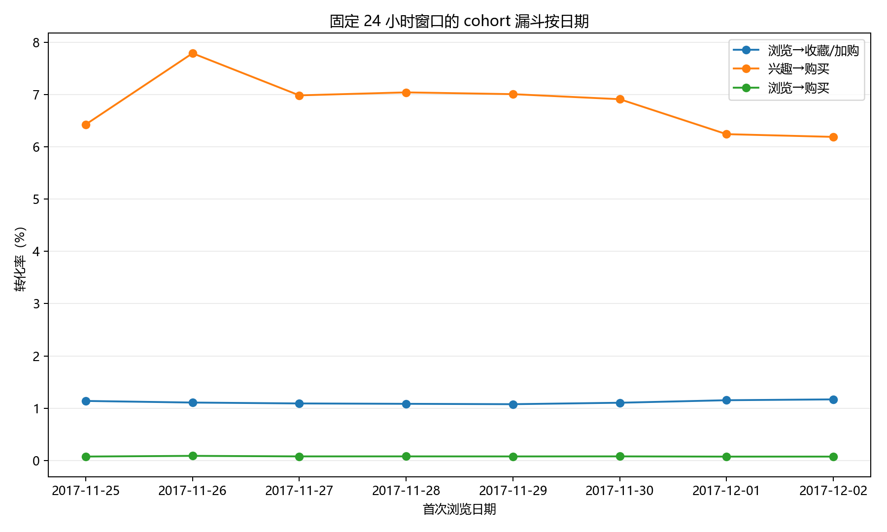
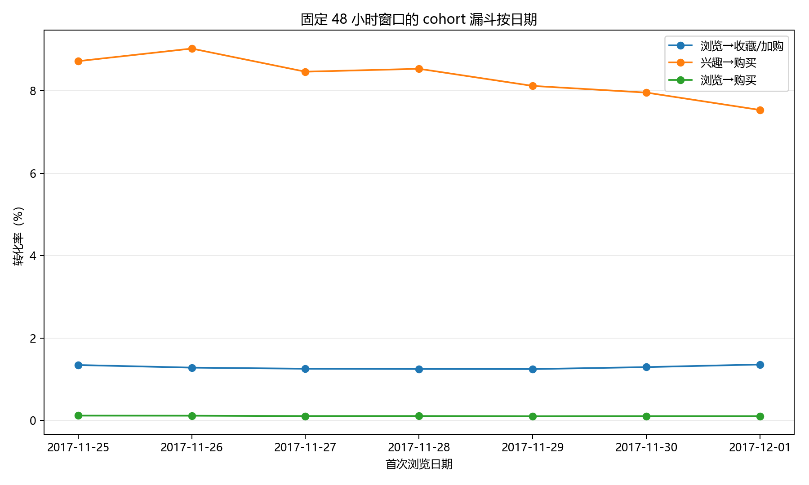

# 淘宝用户行为漏斗 会话路径与用户分层分析

> 基于阿里云天池淘宝用户行为数据的用户级覆盖、商品级严格漏斗、固定窗口 cohort、启发式会话路径、规则分层与窗口内验证项目。技术栈：DuckDB + SQL + Python + Pandas + Matplotlib。

## 成果速览

| 分析主题 | 核心结果 |
|---|---|
| 数据清洗 | 原始 100,150,807 条，清洗后 100,095,231 条；完全重复行仅 49 条 |
| 商品级严格漏斗 | 浏览→兴趣 1.5179%；兴趣→购买 8.7235%；浏览→购买（含直接购买）1.3981% |
| fav/cart 子漏斗 | 收藏→购买 7.9814%；加购→购买 9.1635%；两条子漏斗不互斥 |
| 直接购买 | 浏览后购买组合中 90.5293% 在购买前没有收藏或加购 |
| 会话路径 | 30 分钟启发式会话中，72.13% 仅浏览或未形成后续行为；浏览→加购未购 12.25% |
| 用户分层验证 | 近期高频购买用户后续 3 天购买率 56.22%；高浏览未购买用户 29.28% |
| 运营优先级 | 优先验证加购后未购买召回、高浏览未购买详情页优化和窗口早期高频用户召回 |

> 用户级 37.44% 等结果在本项目中只作为行为覆盖或历史基线，不作为标准转化率。正文的转化判断使用同一用户同一商品的严格漏斗。

## 1. 项目背景与业务问题

电商运营通常需要同时回答两个问题：

1. 用户在浏览、收藏/加购和购买之间主要在哪个环节流失？
2. 哪些用户值得维护、召回或培养？

本项目进一步把分析结果转化为可验证的运营假设，而不是把相关关系直接写成因果结论。

## 2. 项目结构

```text
taobao-user-analysis/
├── data/
│   ├── raw/                         # 原始 CSV，不上传 GitHub
│   └── processed/                   # 清洗数据、汇总表和验证结果
├── figures/                         # PNG 图表
├── src/
│   ├── p0_rebuild_metrics_duckdb.py # P0 指标和固定窗口重算
│   ├── p0_revised_segmentation_duckdb.py
│   ├── p1_analysis_duckdb.py        # 分层验证、敏感性、cohort、质量审计
│   ├── p1_session_paths_duckdb.py   # 会话切分和路径矩阵
│   └── p2_robustness_ci.py          # bootstrap 区间
├── README.md                        # 项目入口
├── PROJECT_REPORT_FINAL.md          # 完整逻辑报告
└── GITHUB_Taobao_User_Behavior_Analysis_final.md
```

## 3. 数据获取与字段

数据来源：[阿里云天池淘宝用户购物行为数据集](https://tianchi.aliyun.com/dataset/dataDetail?dataId=649)

原始字段：

```text
user_id, item_id, category_id, behavior_type, timestamp
```

行为类型：

```text
pv    浏览
fav   收藏
cart  加购
buy   购买
```

数据集时间范围为 2017-11-25 至 2017-12-03。本项目按 `Asia/Shanghai` 转换 Unix 时间戳，并保留中国时区下的完整观察期。

下载原始文件后，将其放置为：

```text
data/raw/UserBehavior.csv
```

原始文件体积较大，不应直接提交到 GitHub。应在 README 中保留来源和下载方式。

## 4. 数据清洗与质量审计

### 4.1 清洗规则

1. 保留原始文件，不直接修改；
2. 删除字段缺失记录；
3. 只保留 `pv`、`fav`、`cart`、`buy`；
4. 按中国时区转换 Unix 时间戳；
5. 过滤观察期外记录；
6. 保留重复行为，因为重复浏览可能是真实行为；
7. 使用 DuckDB 和分块读取，避免一次性把 1 亿行读入内存。

### 4.2 清洗结果

| 指标 | 结果 |
|---|---:|
| 清洗前记录数 | 100,150,807 |
| 清洗后记录数 | 100,095,231 |
| 删除记录数 | 55,576 |
| 用户数 | 987,991 |
| 商品数 | 4,161,138 |
| 类目数 | 9,437 |
| 完全重复行 | 49 |
| 人均事件数 P50/P90/P99 | 75/218/408 |

### 4.3 重要质量发现

- 有购买但没有浏览的 user-item 组合为 619,788，占购买组合约 32.18%；
- 浏览后购买但购买前没有 fav/cart 的组合为 898,840；
- 这些记录可能来自观察窗口外行为、直接购买或日志链路不完整，因此不能简单删除。

质量结果：[p1_data_quality_summary.csv](data/processed/p1_data_quality_summary.csv)

## 5. 指标口径设计

### 5.1 用户级行为覆盖

定义：以用户为粒度，判断用户在 9 天内是否先浏览、再发生收藏/加购、之后购买。

目的：描述用户整体行为覆盖。

限制：用户可能在不同商品和不同访问中完成这些行为，因此不能直接称为标准转化率。

结果：

| 阶段 | 用户数 |
|---|---:|
| 浏览 | 984,105 |
| 浏览后兴趣 | 796,592 |
| 兴趣后购买 | 381,352 |

### 5.2 商品级严格漏斗

定义：以 `user_id + item_id` 为粒度，要求同一用户在同一商品上按时间发生浏览、收藏/加购和购买。

目的：减少跨商品行为混合，更接近单商品转化。

限制：没有订单 ID、金额和真实 session_id，所以仍不是订单漏斗或收入漏斗。

### 5.3 fav/cart 子漏斗

`fav` 和 `cart` 分别计算，且两者不互斥：

- 浏览→收藏：0.4736%；
- 浏览→加购：1.0705%；
- 收藏→购买：7.9814%；
- 加购→购买：9.1635%。

不能把收藏和加购的组合数直接相加。

## 6. 商品级严格漏斗结果

| 指标 | 分子/分母 | 结果 |
|---|---|---:|
| 浏览→收藏或加购 | 1,077,920 / 71,015,192 | 1.5179% |
| 浏览→收藏 | 336,357 / 71,015,192 | 0.4736% |
| 浏览→加购 | 760,252 / 71,015,192 | 1.0705% |
| 收藏→购买 | 26,846 / 336,357 | 7.9814% |
| 加购→购买 | 69,666 / 760,252 | 9.1635% |
| 兴趣→购买 | 94,032 / 1,077,920 | 8.7235% |
| 浏览→购买（含直接购买） | 992,872 / 71,015,192 | 1.3981% |
| 直接购买占浏览后购买 | 898,840 / 992,872 | 90.5293% |

### 6.1 结果解释

浏览到兴趣行为是数量损失最大的环节；加购到购买率略高于收藏到购买率，因此加购用户更适合购物车提醒、库存提醒或限时优惠。直接购买占比较高，说明不能把所有购买都解释为“浏览→加购→购买”路径。

结果表：[p0_same_item_funnel_summary.csv](data/processed/p0_same_item_funnel_summary.csv)

## 7. 日期、小时与品类分析

### 7.1 为什么使用固定结果窗口

如果把整个 9 天观察期都用于计算购买，12 月 3 日的浏览没有足够时间等待后续购买，会产生右删失。为避免把观察时长差异误读为业绩趋势，项目采用：

- 24 小时结果窗口：保留截至 12 月 2 日的 cohort；
- 48 小时结果窗口：保留截至 12 月 1 日的 cohort。

### 7.2 日期和小时图表






日期图只能解释为 cohort 结果，不能直接解释为日常经营趋势。小时结果是探索性证据，需要进一步控制日期和用户构成。

### 7.3 品类结果与不确定性

类目 ID 已脱敏，项目不虚构实际品类名称。固定窗口品类结果同时提供 bootstrap 95% 区间：


结果表：

- [24 小时小时区间](data/processed/p2_24h_by_hour_ci.csv)
- [24 小时品类区间](data/processed/p2_24h_by_category_ci.csv)
- [48 小时小时区间](data/processed/p2_48h_by_hour_ci.csv)
- [48 小时品类区间](data/processed/p2_48h_by_category_ci.csv)

## 8. 会话路径分析

### 8.1 定义与目的

原始数据没有 `session_id`，因此使用同一用户连续两次行为间隔不超过 30 分钟构造启发式会话，并用 15/30/60 分钟做敏感性分析。

目的：把 9 天的用户级行为拆成更接近一次访问的决策单元，观察用户是直接购买、加购后购买，还是停留在兴趣阶段。

### 8.2 30 分钟主结果

| 路径 | 会话数 | 占比 |
|---|---:|---:|
| 仅浏览或未形成后续行为 | 11,926,927 | 72.13% |
| 浏览→加购未购 | 2,025,668 | 12.25% |
| 无浏览行为会话 | 955,877 | 5.78% |
| 浏览→收藏未购 | 785,769 | 4.75% |
| 浏览→购买直购 | 632,261 | 3.82% |
| 浏览→加购→购买 | 152,158 | 0.92% |
| 浏览→收藏→购买 | 57,196 | 0.35% |

### 8.3 阈值敏感性

| 静默阈值 | 浏览→兴趣 | 兴趣→购买 | 浏览→购买 |
|---|---:|---:|---:|
| 15 分钟 | 17.28% | 8.31% | 4.97% |
| 30 分钟 | 19.39% | 9.70% | 6.05% |
| 60 分钟 | 21.48% | 10.97% | 7.11% |

阈值越长，越多行为被合并进同一会话，因此会话结果必须同时报告阈值，不能当作唯一真值。

结果表：[p1_session_path_matrix.csv](data/processed/p1_session_path_matrix.csv)

## 9 用户分层与窗口内验证

### 9.1 分层规则

本项目采用规则分层，而不包装成完整 RFM：

- 最近 2 天内购买：近期；
- 距离特征截止日超过 5 天：窗口早期；
- 至少 3 次购买行为：高频；
- 特征期 `pv_count` 第 75 分位：122 次；
- 没有金额字段，因此不计算 M。

### 9.2 特征期与结果期

特征期为 11 月 25 日–11 月 30 日，结果期为 12 月 1 日–12 月 3 日。分层只使用特征期，购买率只使用后续 3 天，因此这是窗口内验证，不是长期样本外预测。

| 用户群 | 特征期用户数 | 后续 3 天购买率 | Wilson 95% CI |
|---|---:|---:|---:|
| 近期高频购买 | 113,510 | 56.22% | 55.93%–56.51% |
| 窗口早期高频购买 | 3,951 | 45.84% | 44.29%–47.39% |
| 中期购买 | 219,920 | 42.94% | 42.73%–43.14% |
| 近期低频购买 | 144,237 | 42.65% | 42.40%–42.91% |
| 近5日未购低频 | 44,621 | 40.76% | 40.31%–41.22% |
| 低浏览未购买 | 388,903 | 32.08% | 31.94%–32.23% |
| 高浏览未购买 | 72,575 | 29.28% | 28.95%–29.61% |

3 天活跃率几乎饱和，因此不作为主要决策指标。

结果表：[p1_segment_validation_summary.csv](data/processed/p1_segment_validation_summary.csv)

## 10. Cohort 与复购最小版本

由于没有注册时间，项目不称“新用户留存”，而是分析“窗口内首购 cohort”。D1 对 12 月 2 日前 cohort 完整，D3 对 11 月 30 日前 cohort 完整。

完整 D3 cohort 的购买率约为 16.29%–21.03%，D1 购买率约为 16.92%–23.12%。这只能解释为窗口内首购后的短期行为，不能解释长期生命周期。

结果表：[p1_window_first_purchase_cohort.csv](data/processed/p1_window_first_purchase_cohort.csv)

## 11. 运营优先级与敏感性测算

### 11.1 敏感性测算

| 目标 | 规模 | +1pp | +3pp | +5pp |
|---|---:|---:|---:|---:|
| 加购后未购买 user-item | 690,586 | 6,906 | 20,718 | 34,529 |
| 高浏览未购买用户 | 53,125 | 531 | 1,594 | 2,656 |
| 浏览→兴趣整体 user-item | 71,015,192 | 710,152 | 2,130,456 | 3,550,760 |
| 窗口早期高频购买用户 | 28,606 | 286 | 858 | 1,430 |

增量单位是 user 或 user-item，不是订单或收入预测。

### 11.2 运营假设

1. 对加购后未购买用户建议考虑购物车提醒、库存提醒或限时优惠；
2. 对高浏览未购买用户建议考虑详情页利益点、价格信息和加购入口优化；
3. 对窗口早期高频购买用户建议考虑低成本个性化召回；
4. 不把低浏览未购买用户作为第一优先级的大规模投放对象。

## 12. 技术实现要点

- DuckDB 直接对清洗后的大 CSV 做条件聚合，避免将 1 亿行整体读入 Pandas；
- 商品级漏斗使用条件聚合和首次事件时间；
- 日期/小时/品类使用固定结果窗口，降低右删失；
- 会话使用窗口函数、用户内时间排序和静默阈值敏感性；
- 分层验证按时间切分，避免使用结果期行为构造特征；
- 购买率使用 Wilson 区间，小时/品类结果增加二项 bootstrap 区间；
- 原始数据、清洗数据、指标表和图表分目录保存，保证结果可复现。

## 13. 局限与下一步

### 局限

1. 没有价格、金额、数量和订单 ID，无法计算 GMV、客单价、ROI 或真实订单数；
2. 没有原生会话 ID，会话是启发式构造；
3. 观察期只有 9 天，不能解释长期生命周期；
4. 固定窗口只能降低日期右删失，不能完全消除；
5. 分层验证是窗口内 3 天验证，不是长期样本外预测；
6. 历史观察日志不能单独证明运营动作具有因果效果；
7. 类目 ID 脱敏，不能推断实际品类名称；
8. 数据来自 2017 年，不能直接代表当前平台规律。

### 可扩展方向

- 获取金额和订单字段后，补充真实 RFM、GMV、客单价和 ROI；
- 获取真实 session_id 后，替换启发式会话；
- 获取更长观察期后，做长期 retention 和复购间隔分析；
- 获取更长观察期、金额和订单字段后，进一步验证召回和详情页优化的业务价值。

## 14. 复现方式

安装依赖：

```bash
pip install pandas numpy matplotlib duckdb
```

推荐执行顺序：

```bash
python src/p0_rebuild_metrics_duckdb.py
python src/p0_revised_segmentation_duckdb.py
python src/p1_analysis_duckdb.py
python src/p1_session_paths_duckdb.py
python src/p2_robustness_ci.py
```

核心结果目录：

```text
data/processed/
figures/
```

原始多 GB CSV 不应提交到 GitHub。应在仓库中保留数据来源、下载方式、脚本、图表和指标口径说明。
